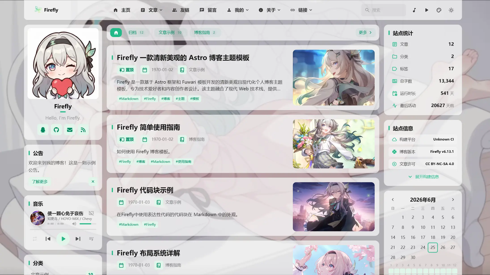
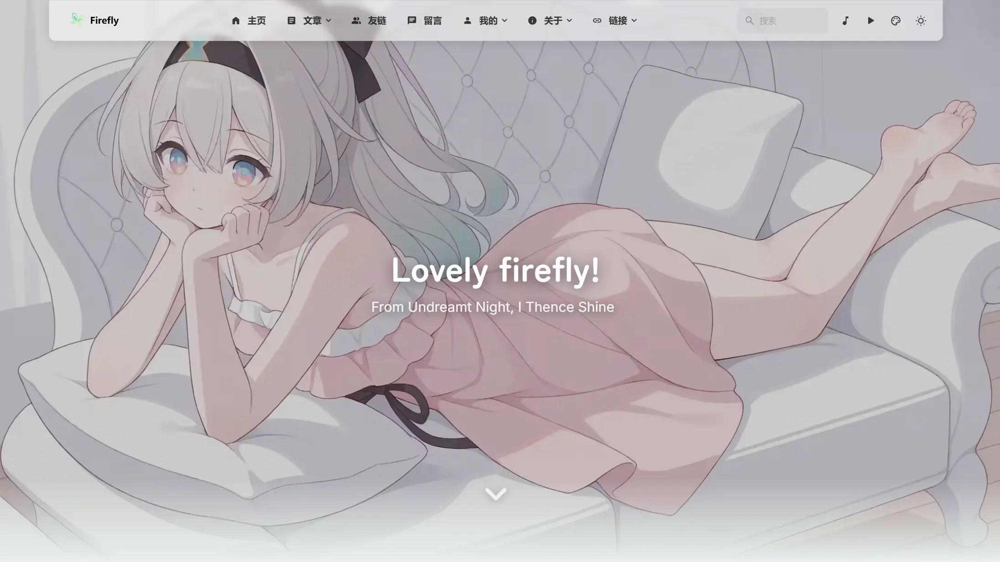
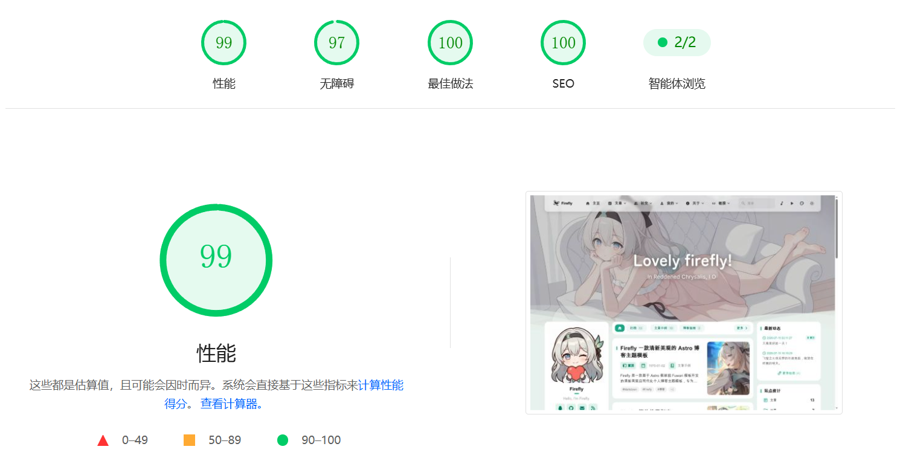

<div align="center">

# Firefly · 左沐の手册
> A Fresh and Beautiful Astro Static Blog Theme Template
> 
> This site is a personal fork of [Firefly](https://github.com/CuteLeaf/Firefly) (v6.16.8), named "左沐の手册" and served from [azuma.mstzuomu.space](https://azuma.mstzuomu.space)
> 
>  


>
> [](https://github.com/jmqsOOOtatoba/FireflyPriWeb/stargazers)
[](https://github.com/jmqsOOOtatoba/FireflyPriWeb/network/members)
[](https://github.com/jmqsOOOtatoba/FireflyPriWeb/issues)
> 
> [](https://ko-fi.com/Z8Z41NQALY)
>
> **QQ交流群：[1087127207](https://qm.qq.com/q/ZGsFa8qX2G)**
> 
> 
[](https://deepwiki.com/CuteLeaf/Firefly)
[](https://ifdian.net/a/cuteleaf)
</div>


---
📖 README:
**[简体中文](README.md)** | **[繁體中文](docs/README.zh-TW.md)** | **[English](README.en.md)** | **[日本語](docs/README.ja.md)** | **[한국어](docs/README.ko.md)**

🚀 Quick Guide:
[**🖥️Live Site**](https://azuma.mstzuomu.space/) /
[**📝Theme Docs**](https://docs-firefly.cuteleaf.cn/) /
[**📊Public Analytics**](https://azuma.mstzuomu.space/analytics/)

⚡ Static Site Generation: Ultra-fast loading speed and SEO optimization based on Astro

🎨 Modern Design: Clean and beautiful interface with customizable theme colors

📱 Mobile-Friendly: Perfect responsive experience with mobile-specific optimizations

🔧 Highly Configurable: Most features can be customized through configuration files

<table width="100%" align="center">
  <tr>
    <td colspan="3" align="center">
      
      <br>Banner Mode</td>
    </td>
  </tr>
  <tr>
    <td align="center"><br>Overlay Mode</td>
    <td align="center"><br>Fullscreen Wallpaper Mode</td>
    <td align="center"><br>Solid Color Mode</td>
  </tr>
</table>


>[!TIP]
>
>Firefly is a fresh, beautiful, and modern personal blog theme template based on the Astro framework and the Fuwari template, designed for tech enthusiasts and content creators. It integrates a modern web tech stack, offering rich feature modules and a highly customizable interface so you can easily build a professional and visually appealing personal blog.
>
>**If you refer to or use Firefly component design and related code, please credit Firefly.**
>
>Firefly also preserves the original fuwari layout, which can be freely switched in the configuration file according to your preferences.
>
>**For more layout configurations and demos, please see: [Firefly Layout System Details](https://firefly.cuteleaf.cn/posts/guide/firefly-layout-system/)**
>
>Firefly supports i18n multilingual UI, but except for Simplified Chinese, other languages are AI-translated. If you find any errors, feel free to submit a [Pull Request](https://github.com/CuteLeaf/Firefly/pulls) to help improve them.

## ✨ Features

### Core Features

- [x] **Astro + Tailwind CSS** - Ultra-fast static site generation based on modern tech stack
- [x] **Smooth Animations** - Swup page transition animations for silky smooth browsing experience
- [x] **Responsive Design** - Perfect adaptation for desktop, tablet and mobile devices
- [x] **Multi-language Support** - i18n internationalization ui, supports Simplified Chinese, Traditional Chinese, English, Japanese, Russian, Korean
- [x] **Full-text Search** - Client-side search based on Pagefind, supports article content indexing.

### Personalization
- [x] **Dynamic Sidebar** - Supports single sidebar, dual sidebar configuration
- [x] **Article Layout** - Supports list (single column) and grid (multi-column/masonry) layout
- [x] **Font Management** - Custom font support with rich font selector
- [x] **Footer Configuration** - HTML content injection, fully customizable
- [x] **Light/Dark Mode** - Supports light/dark/system three modes
- [x] **Navbar Customization** - Logo, title, links fully customizable
- [x] **Wallpaper Mode Switching** - Banner wallpaper, fullscreen wallpaper, fullscreen transparent wallpaper, solid background
- [x] **Theme Color Customization** - 360° hue adjustment


If you have useful features and optimizations, please submit a [Pull Request](https://github.com/CuteLeaf/Firefly/pulls)

### Personal Additions

- [x] **Friend Circle** - `/fcircle/` aggregates recent posts from friend-link RSS feeds
- [x] **Bookmark Nav** - `/booknav/` categorized bookmark directory, driven by `booknavConfig.ts`
- [x] **Gallery** - `/gallery/` photo album page
- [x] **Moments** - `/dynamic/` short-form timeline with pinning, location and a Memos data source
- [x] **Projects** - `/projects/` project showcase page
- [x] **Guestbook** - `/guestbook/` visitor messages
- [x] **Bangumi & Bilibili** - Bangumi collection shelves and Bilibili watch progress
- [x] **Analytics** - Self-hosted Umami (`umami.mstzuomu.space`) plus a public stats page at `/analytics/`, linked from the navbar; Busuanzi was removed entirely
- [x] **Publisher** - `publisher/` is a standalone Vercel project (`pub.mstzuomu.space`) exposing six APIs: article / articles / auth / friend-apply / friend-decide / publish
- [x] **Self-service Friend Links** - Submitted through a form, reviewed by email, with an optional rejection reason
- [x] **Visitor Info** - Visitor location, weather and temperature, plus weather alerts
- [x] **Site Stats** - Post count, category count, tag count, total word count and uptime
- [x] **Reading Comfort** - Reading progress bar and circular indicator, plus an immersive reading mode
- [x] **Twikoo Comments** - Self-hosted comment service (`twikoo.mstzuomu.space`)
- [x] **Bilibili Card** - `::bilibili{uid="..."}` directive renders an uploader card
- [x] **Music Player** - Global music player plus the `::music` directive
- [x] **Image Hosting** - Dedicated host at `tu.mstzuomu.space`
- [x] **Dual ICP Footer** - 鲁ICP备2026062086号-1 plus the public-security filing number and badge, injected through `FooterConfig.html`

## 🚀 Quick Start

### Requirements

- Node.js ≥ 22.23.0 (see `engines.node` in `package.json`)
- pnpm 11.22.0 (see `packageManager` in `package.json`)

### Local Development

1. **Clone the repository:**
   ```bash
   git clone https://github.com/jmqsOOOtatoba/FireflyPriWeb.git
   cd FireflyPriWeb
   ```
   
   **If you want to build your own site on top of this repo, [Fork](https://github.com/jmqsOOOtatoba/FireflyPriWeb/fork) it first and then clone:**

   ```bash
   git clone https://github.com/you-github-name/FireflyPriWeb.git
   cd FireflyPriWeb
   ```
3. **Install dependencies:**
   ```bash
   # Install pnpm if not installed
   npm install -g pnpm
   
   # Install project dependencies
   pnpm install
   ```

4. **Configure blog:**
   - Edit configuration files in `src/config/` directory to customize blog settings

5. **Start development server:**
   ```bash
   pnpm dev
   ```
   Blog will be available at `http://localhost:4321`

### Platform Hosting Deployment

This site is deployed on **Tencent Cloud EdgeOne Pages**: pushing to the GitHub `master` branch triggers a build and publishes plain static files.

- Framework Preset: `Astro`
- Root Directory: `./`
- Output Directory: `dist`
- Build Command: `pnpm run build`
- Install Command: `pnpm install`

Any other static host (Vercel, Netlify, Cloudflare Pages, etc.) works just as well — configure it following the [official Astro deployment guide](https://docs.astro.build/en/guides/deploy/).

**A few notes:**

- The canonical entry point is <https://azuma.mstzuomu.space>, defined as `site_url` in `src/config/siteConfig.ts`; `www.mstzuomu.space` and the bare domain 302-redirect to it (see `Layout.astro`).
- The `wrangler.jsonc`, `wrangler.toml` and `vercel.json` files at the repository root are leftovers from the upstream template and are not part of this site's deployment.
- `astro.config.mjs` only attaches the Cloudflare adapter when the `CF_WORKERS` environment variable is present; the default is a plain static build with no adapter at all.

## 📖 Configuration

> 📚 **Detailed Configuration Documentation**: Check [Firefly Documentation](https://docs-firefly.cuteleaf.cn/) for complete configuration guide

### Setting Website Language

To set the default language for your blog, edit the `src/config/siteConfig.ts` file:

```typescript
// Define site language
const SITE_LANG = "zh_CN";
```

**Supported language codes:**
- `zh_CN` - Simplified Chinese
- `zh_TW` - Traditional Chinese
- `en` - English
- `ja` - Japanese
- `ru` - Russian
- `ko` - Korean

### Configuration File Structure

```
src/
├── config/
│   ├── index.ts                  # Configuration index file
│   ├── siteConfig.ts             # Site basic configuration
│   ├── analyticsConfig.ts        # Analytics configuration
│   ├── announcementConfig.ts     # Announcement configuration
│   ├── backgroundWallpaper.ts    # Background wallpaper configuration
│   ├── booknavConfig.ts          # Bookmark navigation configuration
│   ├── commentConfig.ts          # Comment system configuration
│   ├── coverImageConfig.ts       # Cover image configuration
│   ├── displaySettingsConfig.ts  # Settings panel configuration
│   ├── dynamicConfig.ts          # Moments page configuration
│   ├── effectsConfig.ts          # Animation effects config (sakura, etc.)
│   ├── expressiveCodeConfig.ts   # Code highlighting configuration
│   ├── fcircleConfig.ts          # Friend circle configuration
│   ├── fontConfig.ts             # Font configuration
│   ├── FooterConfig.html           # Footer configuration
│   ├── friendsConfig.ts          # Friend links configuration
│   ├── galleryConfig.ts          # Gallery configuration
│   ├── licenseConfig.ts          # License configuration
│   ├── musicConfig.ts            # Music player configuration
│   ├── navBarConfig.ts           # Navbar configuration
│   ├── pioConfig.ts              # Mascot configuration
│   ├── mermaidConfig.ts          # Mermaid diagram configuration
│   ├── plantumlConfig.ts         # PlantUML diagram configuration
│   ├── profileConfig.ts          # User profile configuration
│   ├── sidebarConfig.ts          # Sidebar layout configuration
│   └── sponsorConfig.ts          # Sponsor configuration
```


## ⚙️ Article Frontmatter

```yaml
---
title: My First Blog Post
published: 2023-09-09
description: This is the first post of my new Astro blog.
image: ./cover.jpg  # Or use "api" to enable random cover images
tags: [Foo, Bar]
category: Front-end
draft: false
lang: zh-CN      # Only set when article language differs from site language in `siteConfig.ts`
pinned: false    # Pin article
comment: true    # Enable comments
---
```

## Moments

Moment files are stored in `src/content/dynamic/`, with one Markdown file per moment. Create one with:

```bash
pnpm new-d The weather is lovely today
```

`pnpm new-dynamic <content>` is the equivalent full command.

```yaml
---
published: 2026-07-15 16:15:29
pinned: true  # Pin article
location: China # Location
---

Moment content supports Markdown.
```

Also supports [Memos](https://www.usememos.com/) as a data source. Configure the `memos` option in `src/config/dynamicConfig.ts` to fetch Memos moments in real-time, with pinned sync and image attachment support. See [Moments documentation](https://docs-firefly.cuteleaf.cn/en/guide/dynamic.html).

## 📖 Markdown Extensions

In addition to the default [GitHub Flavored Markdown](https://github.github.com/gfm/) support in Astro, more than 20 remark / rehype plugins live under `src/plugins/` and provide the following extensions:

- Admonitions - Supports configuration for GitHub, Obsidian, VitePress, and Docusaurus themes ([Preview and Usage](https://firefly.cuteleaf.cn/posts/markdown-extended/))
- GitHub Repository Cards ([Preview and Usage](https://firefly.cuteleaf.cn/posts/markdown-extended/))
- Enhanced Code Blocks based on Expressive Code ([Preview](http://firefly.cuteleaf.cn/posts/code-examples/) / [Documentation](https://expressive-code.com/))
- Bilibili User Card - `::bilibili{uid="353880725"}`; the avatar and nickname are fetched at build time and rendered as a full card
- Music Player - `::music{url="..."}` or `::music{server="netease" id="..."}`
- PDF Viewer - `::pdf{url="https://example.com/file.pdf"}`
- Mermaid Diagrams - Rendered from code blocks, with zoom and pan
- PlantUML Diagrams - Rendered from code blocks, with theme switching plus zoom and pan
- Wiki Links - `[[post-path]]` style internal links, resolved to the target title and URL
- Image Grid - Multiple images are laid out automatically as a grid
- Email Protection - Addresses in the body are encoded automatically to defeat scrapers
- External Links - Off-site links get `target` / `rel` attributes added automatically
- Figures - Images are wrapped in `<figure>` with optional captions
- Reading Time and Excerpt - Reading time and post excerpts are generated at build time

## 🧞 Commands

All commands need to be executed in the project root directory:

| Command                      | Action                                                          |
|:-----------------------------|:----------------------------------------------------------------|
| `pnpm install`               | Install dependencies (`preinstall` enforces pnpm only)            |
| `pnpm dev`                   | Start local development server at `localhost:4321` (same as `pnpm start`) |
| `pnpm build`                 | Run the full 10-step build pipeline and output to `./dist/`      |
| `pnpm preview`               | Preview built site locally                                       |
| `pnpm check`                 | Run Astro diagnostics and check for errors in code               |
| `pnpm type-check`            | Run the TypeScript check (`tsc --noEmit`)                        |
| `pnpm format`                | Format `src` and `scripts` using Biome                           |
| `pnpm lint`                  | Lint and safely fix `src` and `scripts` using Biome              |
| `pnpm new-post <filename>`   | Create new article                                               |
| `pnpm new-d <content>`       | Create a new moment (alias of `new-dynamic`)                     |
| `pnpm new-dynamic <content>` | Create a new moment (full command)                               |
| `pnpm lqips`                 | Regenerate only the image LQIP placeholders                      |
| `pnpm friend-json`           | Regenerate only the friend-links JSON                            |
| `pnpm github-cards`          | Regenerate only the GitHub card data                             |
| `pnpm bilibili-cards`        | Regenerate only the Bilibili card data                           |
| `pnpm astro ...`             | Execute `astro add`, `astro check` and other commands            |
| `pnpm astro --help`          | Display Astro CLI help                                           |

`pnpm build` is a composite command that runs ten steps in order:

generate friend-links JSON → generate GitHub card data → generate Bilibili card data → generate LQIP placeholders → generate VNDB covers → `astro build` → prune mascot assets → subset fonts → minify inline scripts → run Pagefind indexing.

## 🙏 Acknowledgments

Special thanks to [saicaca](https://github.com/saicaca) for developing the [fuwari](https://github.com/saicaca/fuwari) template, which Firefly is based on for secondary development.

The copyright of Firefly-related image assets belongs to [miHoYo](https://www.mihoyo.com/), the developer of the game ["Honkai: Star Rail"](https://sr.mihoyo.com/).

### Tech Stack

- [Astro](https://astro.build) 
- [Tailwind CSS](https://tailwindcss.com) 
- [Iconify](https://iconify.design)

### Inspiration Projects

- [fuwari](https://github.com/saicaca/fuwari)
- [hexo-theme-shoka](https://github.com/amehime/hexo-theme-shoka)
- [astro-koharu](https://github.com/cosZone/astro-koharu)
- [Mizuki](https://github.com/matsuzaka-yuki/Mizuki)

### Other References
- Blogger `霞葉` [Bangumi Collection](https://kasuha.com/posts/fuwari-enhance-ep2/) page component
- Bilibili creator `公公的日常` Q-version [Firefly Mascot Spine Model](https://www.bilibili.com/video/BV1fuVzzdE5y)

## 📝 License

This project is licensed under the [MIT license](https://mit-license.org/). See the [LICENSE](./LICENSE) file for details.

Originally forked from [saicaca/fuwari](https://github.com/saicaca/fuwari). Thanks to the original author for their contributions. 

**Copyright Notice:**
- Copyright (c) 2024 [saicaca](https://github.com/saicaca) - [fuwari](https://github.com/saicaca/fuwari)
- Copyright (c) 2025 [CuteLeaf](https://github.com/CuteLeaf) - [Firefly](https://github.com/CuteLeaf/Firefly)

Under the MIT license, you are free to use, modify, and distribute the code, but you must retain the above copyright notice.

## 🍀 Contributors

Thanks to the following contributors for their contributions to this project. If you have any questions or suggestions, please submit an [Issue](https://github.com/CuteLeaf/Firefly/issues) or [Pull Request](https://github.com/CuteLeaf/Firefly/pulls).

><a href="https://github.com/CuteLeaf/Firefly/graphs/contributors">
>  
></a>

Thanks to the following contributors for their contributions to the original project [fuwari](https://github.com/saicaca/fuwari), which laid the foundation for this project.

><a href="https://github.com/saicaca/fuwari/graphs/contributors">
>  
></a>

## ⭐ Star History

[](https://star-history.com/#CuteLeaf/Firefly&Date)


<!-- ALL-CONTRIBUTORS-LIST:START - Do not remove or modify this section -->
<!-- prettier-ignore-start -->
<!-- markdownlint-disable -->

<!-- markdownlint-restore -->
<!-- prettier-ignore-end -->

<!-- ALL-CONTRIBUTORS-LIST:END -->
