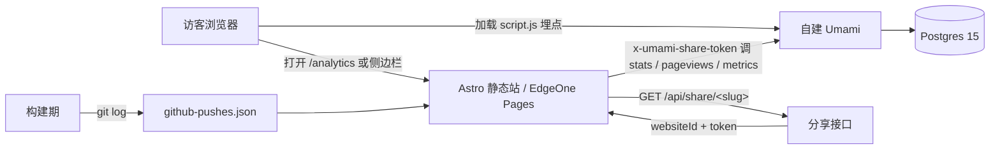

# 给站点统计安个家：自建 Umami + 公开统计页 /analytics 的完整复刻手册

2026-10，本站把站点统计从不蒜子（busuanzi）整体迁到**自建 Umami**，并顺手把一个开源公开统计页移植成了自己的 `/analytics`：`访客 → 博客页面 → Umami 分享接口 → 自建 Umami → Postgres`。侧边栏的 SiteStats 与公开统计页共用同一数据源；主站仍在腾讯云 EdgeOne Pages 上纯静态部署，统计接口跑在自己那台备案轻量服务器上。前后折腾了部署、历史数据迁移、博客端改造和移植后一连串修整，把过程和踩过的坑一并记下。

本文写给两类读者：

- **想复现的访客**：文末「复刻清单」从零列出全部步骤，关键配置可照抄，不依赖本站任何私有环境；
- **未来的维护者（包括新会话的 AI 助手）**：读完应知道数据链每一段在哪、版本为什么要钉死、哪些 API 语义坑已经填过。

---

## 一、背景：从不蒜子到自建 Umami

原先的访客计数挂在不蒜子上：一行脚本，零运维，但也只剩一个「访问量」数字。想要趋势、热门页面、设备分布、活跃时段，不蒜子给不了；租第三方统计面板又与「数据在自己手里」的初衷相悖。目标于是收敛成三条：

1. **数据自持**：埋点、原始事件、聚合结果都落在自己的 Postgres 里；
2. **对外可看**：读者打开 `/analytics` 就能看到站点活力，不必登录后台；
3. **与主题共生**：侧边栏统计和公开页读同一套接口，不再维护两套数字。

公开统计页的 UI 移植自开源主题 **Aemeath**（GitHub：`Jarvis0227/Aemeath`，MIT 协议），原版是一个约 3900 行的单文件组件。它把「公开统计页」该有的模块基本凑齐了：hero 区、总览卡、趋势图、热门页面、设备与浏览器、流量来源、GitHub 推送热力图、活跃时段热力图、最近评论。移植的工作量主要不在抄界面，而在把它对接的云端 Umami API 换成本地 v2.20 的那一套——语义并不完全一致，后文会展开。

---

## 二、架构与数据链

整体拓扑很朴素，数据只走一条道：



几条边界值得写明：

- **主站是纯静态的**。EdgeOne Pages 在 push `master` 时自动构建，不跑服务端逻辑；所有「活数据」都由浏览器在运行时去调 Umami 的分享接口取。
- **Umami 在自己的服务器上**。与图床同机，部署目录 `/opt/umami/`，docker-compose 跑两个容器：umami 与 postgres:15-alpine。
- **对外只开只读分享**。公开页拿的是 share slug 换来的 token，权限止步于拉数；写路径（建站、改配置）只留在服务器上的后台。
- **GitHub 推送热力图是构建期产物**，与 Umami 无关，由 `git log` 生成静态 JSON（见第六章）。

---

## 三、服务器端：部署自建 Umami

### 3.1 镜像与版本：必须钉死

最要紧的一条先放前面：**版本钉死 `postgresql-v2.20.2`，千万不要用 `:postgresql-latest`**。

```yaml
# /opt/umami/docker-compose.yml（示例，结构可照抄）
services:
  umami:
    image: ghcr.nju.edu.cn/umami-software/umami:postgresql-v2.20.2
    container_name: umami
    restart: unless-stopped
    ports:
      - "127.0.0.1:3000:3000"
    environment:
      DATABASE_URL: postgresql://umami:自设的强口令@db:5432/umami
      APP_SECRET: 自设的强口令
    depends_on:
      db:
        condition: service_healthy

  db:
    image: mirror.ccs.tencentyun.com/library/postgres:15-alpine
    container_name: umami-db
    restart: unless-stopped
    environment:
      POSTGRES_DB: umami
      POSTGRES_USER: umami
      POSTGRES_PASSWORD: 自设的强口令
    volumes:
      # bind mount，不是 named volume——理由见 3.3
      - /opt/umami/data/db:/var/lib/postgresql/data
    healthcheck:
      test: ["CMD-SHELL", "pg_isready -U umami"]
      interval: 10s
      timeout: 5s
      retries: 5
```

两点选择说明：

- **镜像源**。国内直连 docker.io / ghcr 会卡死，umami 走高校 ghcr 镜像（示例为 `ghcr.nju.edu.cn`，也可换你顺手的 ghcr 代理），postgres 走腾讯云镜像 `mirror.ccs.tencentyun.com/library/postgres:15-alpine`。
- **`:postgresql-latest` 是坏的**（至少在本文写作时）。那是 Next 16 边缘构建，分享页与 API 路由不匹配：`GET /api/share/<slug>` 直接返回 404。实测换回 `v2.20.2` 后同一命令立刻正常。若某天你要升级版本，先单独验分享接口再切流量。

### 3.2 数据目录用 bind mount

`/opt/umami/data/db` 明确挂成 **bind mount** 而不是 named volume。好处在清库时才显出来：`docker compose down -v` 删不掉 bind 目录里的数据，不会因为一次「顺手加 -v」把库端了。真要重来，动作是显式的：

```bash
cd /opt/umami
docker compose down
sudo rm -rf /opt/umami/data/db
sudo mkdir -p /opt/umami/data/db
docker compose up -d
```

### 3.3 域名、证书与入口

1. DNS 加一条 A 记录（示例主机名 `umami`），指到服务器公网 IP；
2. 写 nginx 站点 `/etc/nginx/sites-available/umami`，反代到容器映射出的本机端口；
3. `certbot --nginx` 签证书，续期交给 certbot 的定时任务。

```nginx
# /etc/nginx/sites-available/umami（示例）
server {
    listen 80;
    listen [::]:80;
    server_name umami.你的域名;
    return 301 https://$host$request_uri;
}

server {
    listen 443 ssl;
    listen [::]:443 ssl;
    http2 on;
    server_name umami.你的域名;

    ssl_certificate     /etc/letsencrypt/live/umami.你的域名/fullchain.pem;
    ssl_certificate_key /etc/letsencrypt/live/umami.你的域名/privkey.pem;

    location / {
        proxy_pass http://127.0.0.1:3000;
        proxy_set_header Host $host;
        proxy_set_header X-Real-IP $remote_addr;
        proxy_set_header X-Forwarded-For $proxy_add_x_forwarded_for;
        proxy_set_header X-Forwarded-Proto $scheme;
    }
}
```

完成后 `https://umami.你的域名` 应能打开 Umami 后台。**后台口令自设强口令**，首次登录后立刻改掉默认账号——密码、JWT 一类凭据不落文档，本文之后不再出现。

### 3.4 埋点脚本切换

站点原来挂在云端的 `cloud.umami.is` 埋点，换成自建地址即可：

```html
<script
  defer
  src="https://umami.你的域名/script.js"
  data-website-id="你的websiteId"
></script>
```

本站在主题配置里把这一步收敛成了 `analyticsConfig.ts` 的 `scriptUrl` 与 `websiteId` 字段，改两行配置而非每页硬编码（见第六章）。

---

## 四、公开分享：slug 与只读拉数

这一章是移植公开页的关键，也是 v2.20 与云端 Umami 差异最大的地方。

### 4.1 share_id 只能直写 SQL

站点「分享」链接里的那个 slug，对应数据库 `website.share_id` 字段。麻烦在于：**v2.20 没有创建分享的 API**，界面上生成的分享是一回事，想用稳定的自定义 slug，就得进库写 SQL：

```sql
UPDATE website
   SET share_id = '你的自定义slug'
 WHERE website_id = '你的websiteId';
```

写完后，浏览器访问 `https://umami.你的域名/share/你的自定义slug` 应能看到分享页。slug 是公开可见的，不承担保密职责；真正的只读边界在下一步的 token。

### 4.2 只读拉数固定两步

**第一步**，拿 slug 换凭证：

```bash
curl -s https://umami.你的域名/api/share/<slug>
# 返回形如：{ "websiteId": "你的websiteId", "token": "<JWT>" }
```

**第二步**，带分享头调各统计端点：

```bash
curl -s -H "x-umami-share-token: <token>" -H "x-umami-share-context: 1" \
  "https://umami.你的域名/api/websites/<websiteId>/stats?startAt=...&endAt=...&timezone=Asia/Shanghai"
```

同一组头可复用于 `/stats`、`/pageviews`、`/metrics`、`/sessions` 等。侧边栏 SiteStats 与 `/analytics` 公开页都走这条两步链，只是组装的 UI 不同。

分享拿不到时，本站的策略是**指标显示 `-` 而不是把整个模块藏起来**：布局不跳，读者也能看出「这块暂时没数」而不是「功能被删了」。

### 4.3 v2.20 API 的语义差异

移植时对着云端 Umami 的调用习惯写，几乎每条都踩了一遍。差异集中在这几处：

| 调用 | 云端 Umami | 自建 v2.20 | 写错的后果 |
|---|---|---|---|
| `/metrics` 维度名 | `type=path` | **`type=url`** | 返回 400 |
| `/stats` 返回形状 | 数值 | **`{ value, prev }` 对象** | 按纯数字解析得 NaN→0 |
| `unit=hour` | 可用窗口较宽 | **48 小时硬上限** | 静默降级成 day |
| `/pageviews` | — | **必须带 `timezone`** | 返回 400 |

逐条说：

**`type=url` vs `type=path`**。两者正好相反。自建 v2.20 的 `/metrics` 认 `type=url`，照抄云端的 `type=path` 会直接 400。改过来即可。

**`/stats` 要解包**。返回的是 `{ value, prev }`（当前值与上一窗口对比值），不是纯数字。按 `Number(res)` 解析会得到 NaN，再被展示层兜成 0——趋势图完好、总览卡全零，极具迷惑性。本站写了个 `statNumber()` 统一解包，读 `res.value`，`prev` 留作同比参考。

**`unit=hour` 的 48 小时硬上限**。源码里 `getMinimumUnit()` 规定跨度 `differenceInHours <= 48` 才给 hour 粒度，超了**不报错**，静默降级成 day，返回的时间戳清一色是 `YYYY-MM-DD 00:00:00`。想要近 30 天的小时级曲线，只能把窗口自己切段：本站切 15 段 × 48h，用 `Promise.allSettled` 并行拉取后合并累加。示意：

```ts
// 伪代码：把 30 天切成多段 48h，拼回小时序列
const WINDOWS = 15; // 30 天 × 24h / 48h
const results = await Promise.allSettled(
	Array.from({ length: WINDOWS }, (_, i) => {
		const endAt = startOfRange + (i + 1) * 48 * 3600_000;
		const startAt = endAt - 48 * 3600_000;
		return fetchPageviews({ startAt, endAt, unit: "hour", timezone: TZ });
	}),
);
const hourly = results.flatMap((r) => (r.status === "fulfilled" ? r.value : []));
```

`allSettled` 而不是 `all`：某一段失败只丢那一段，不至于整图清空。

**时间戳别用 `new Date(str)` 解析**。v2.20 返回的字符串是「目标时区的墙上时间」，形如 `2026-09-23 15:00:00`——不是 ISO 格式，中间还是空格。Chrome 会按浏览器本地时区去解释，小时数整体平移；Safari 更干脆，直接 `Invalid Date`。正确做法是正则切出年月日时，星期用 `Date.UTC` 算：

```ts
// "2026-09-23 15:00:00" → 该「墙上日期」的星期几
const m = /^(\d{4})-(\d{2})-(\d{2})/.exec(ts);
if (!m) return null;
const [, y, mo, d] = m;
const weekday = new Date(Date.UTC(Number(y), Number(mo) - 1, Number(d))).getUTCDay();
```

把墙上时间当成 UTC 坐标去取星期，得到的才是「那一串数字所代表的日子」，不受访客浏览器时区干扰。

---

## 五、历史数据迁移（可选步骤）

若旧数据挂在云端 Umami，可以在自建库稳定后做一次「重放」。**这是可选步骤**，跳过也能跑通公开页，只是趋势图前段是空的。

### 5.1 迁移思路

云端 dashboard 提供的是逐日聚合（浏览量 / 访问序列），不是原始事件流。所以迁移方式是：**按天合成 session + website_event 记录**，把当日浏览量按真实占比抽样到设备、浏览器、系统、国家等维度上，让 `/metrics`、`/sessions` 各维度的聚合结果与云端对齐。

幂等性用 `distinct_id` 打标解决：例如统一写成 `history-sync.umami.cloud`。重跑前先删掉同标记的 session，再整段重放，不会越迁越多。

```sql
-- 重跑前清理（示意）
DELETE FROM website_event
 WHERE session_id IN (
   SELECT session_id FROM session
    WHERE distinct_id = 'history-sync.umami.cloud'
 );
DELETE FROM session WHERE distinct_id = 'history-sync.umami.cloud';
```

### 5.2 云端拉数的两个小坑

**登录态在 localStorage**。云端 dashboard 需要鉴权，浏览器 `localStorage` 里的 `umami.auth` 是 JSON 字符串**再包了一层引号**——要 parse 一次拿到字符串、再 parse 一次才是带 token 的对象。只 parse 一次会得到一个字符串，后面当对象用必然报错。

**metrics 参数名又是相反的**。云端是 `type=path`，自建 v2.20 是 `type=url`。同一段拉数代码两边跑，参数名必须各写各的。

### 5.3 语义差异不是 bug

自建 v2 是会话制，「访客数」≈ 访问次数；云端能区分唯一访客。迁移后公开页上的访客数会比云端历史略「厚」，这是模型差异，不是迁移把数弄丢了。看趋势形状和绝对量级即可，别拿两边的 UV 精确对表。

迁移完成后，博客端配置里的 `historicalStats` 偏移量可以归零——数据已经全在库里，展示层不再需要手工补数（见 6.1）。

---

## 六、博客端改造（Astro / Firefly）

### 6.1 配置层

`src/config/analyticsConfig.ts` 与 `src/types/analyticsConfig.ts` 同步扩展 `umamiAnalytics`，新增三个字段：

```ts
umamiAnalytics: {
  websiteId: "你的websiteId",
  scriptUrl: "https://umami.你的域名/script.js",
  shareId: "你的自定义slug",
  shareApiBase: "https://umami.你的域名",
  // 历史偏移：迁移完成后归零；回滚迁移时改回历史累计值
  historicalStats: {
    visitors: 0,
    pageviews: 0,
  },
},
```

- `shareId` / `shareApiBase`：公开页与侧边栏拼接两步分享接口用；
- `historicalStats`：迁移期的展示层偏移，迁完归零，字段留着是为了回滚不用改代码。

类型定义文件记得同步加字段，`pnpm type-check` 才不会红。

### 6.2 侧边栏 SiteStats

`src/components/widget/SiteStats.astro` 改为经「分享接口两步」只读拉数：先 `GET {shareApiBase}/api/share/{shareId}` 拿 `websiteId` 与 `token`，再带 `x-umami-share-token` / `x-umami-share-context: 1` 调 `/stats`。失败时保持 `-`，不隐藏、不硬塞 0；并带 4 秒兜底重试一次，扛住分享接口的偶发抖动。

### 6.3 公开统计页 `/analytics`

`src/pages/analytics.astro` 承接 Aemeath 移植的公开页，模块自上而下：

1. hero 区；
2. 四总览卡（浏览量、访客等）；
3. 趋势图，7 / 30 / 90 天切换；
4. 热门页面；
5. 设备 / 浏览器 donut；
6. 流量来源；
7. GitHub 推送热力图；
8. 活跃时段热力图；
9. 最近评论；
10. 页脚。

导航在「我的」分组下加了「站点统计」入口。

### 6.4 GitHub 推送热力图数据

`src/pages/api/github-pushes.json.ts` 在**构建期**读 `git log` 生成推送数据（prerender，静态 JSON）。EdgeOne 上的浅克隆提交数不够时，脚本会自动 `git fetch --deepen=2000` 再取日志，避免热力图只有最近几天。

### 6.5 有意不搬的三块

移植不是照单全收，三处刻意留下：

| 原版模块 | 不搬的理由 | 若真要做 |
|---|---|---|
| 中国访客地图 | 原版缺南海诸岛 / 九段线，备案站有合规风险 | 换高德 DataV 边界数据另做一套 |
| Waline 评论块 | 本站用 Twikoo | 后来改接 Twikoo 的 `GET_RECENT_COMMENTS` 公开接口 |
| 作者立绘 / hero 图 | 本仓库无对应资源 | 改成 CSS 渐变，视觉自洽 |

评论块那段值得补一句：先砍后接，比硬搬 Waline 干净。Twikoo 的 `GET_RECENT_COMMENTS` 是公开调用，正好够「最近评论」列表用。

### 6.6 移植后立刻修的三处

1. **`type=url`**：上文说过的维度名，云端习惯带过来就 400；
2. **`statNumber()` 解包**：`/stats` 的 `{ value, prev }` 不解包，总览卡全零；
3. **滚动计数动画**：元素未滚入视口时显示 `—`，而不是预画 0。预画 0 会让用户以为「真没数据」，`—` 则明确表示「还没数完」。

### 6.7 主题整合的两条硬约束

自定义的悬浮卡、统计卡必须挂 `card-base` 类，才能跟随全局卡片设置（透明度、边框、圆角）。不挂的话，暗色模式下会变成一块突兀的白板。

另一条更隐蔽：**幽灵 CSS 变量**。写了主题里根本不存在的变量（比如 `--text-color`），样式会静默失效，暗色模式不翻转。办法是写实值，并在 `:root.dark` 下显式覆盖：

```css
.stat-card {
  color: var(--text-main); /* 用主题真实存在的变量 */
  background: var(--card-bg);
}

:root.dark .stat-card {
  color: var(--text-main-dark);
  background: var(--card-bg-dark);
}
```

---

## 七、界面与布局修整（2026-10-23）

功能跑通后，布局又挤出两个问题，连带挖出一个 dev 环境的隐藏坑。

### 7.1 「推送节奏」四小卡文字被截断

四个 `minmax(0, 1fr)` 列 + `nowrap/ellipsis`，放在窄容器里**必然**截断——列宽被内容和容器夹死，省略号成了唯一出口。

第一反应是「把上面那张卡片拉高」，**行不通**：同一网格列里，兄弟节点的高度不影响彼此的宽度。拉高的只是卡片自己，四小卡还是窄。

真正有效的做法有两步：

1. 让该卡片横跨两栏，挣脱单列宽度约束：

```css
.push-rhythm-card {
  grid-column: 1 / -1;
}
```

2. 容器查询兜底：容器宽度 < 860px 时，四个 metrics 折成 2×2，既不截断也不横向溢出。

```css
@container (max-width: 860px) {
  .push-rhythm-metrics {
    grid-template-columns: repeat(2, minmax(0, 1fr));
  }
}
```

### 7.2 「访客活跃时间」与「最近评论」并排

并排之后又冒出两个问题：

- **列表双列太拥挤** → 固定单列；
- **等高拉伸把活跃时间拽长** → 评论卡改用 flex 列表，`flex: 1 1 0` + `min-height` 填充内滚区，使它天然比邻居矮；网格默认的 `stretch` 让它贴底对齐，却不把邻卡一起拉长。

```css
.recent-comments {
  display: flex;
  flex-direction: column;
  flex: 1 1 0;
  min-height: 0;
}

.recent-comments-list {
  flex: 1 1 0;
  min-height: 0;
  overflow: auto;
}
```

要点在于「让矮的那方自己变高」，而不是「把高的那方压矮」。

### 7.3 dev 环境的隐藏坑：陈旧 CSS 模块

改完样式，浏览器上还是旧样子，`curl` 拉到的 SSR HTML 却已是新的——「curl 新、浏览器旧」。根因是浏览器被注入了陈旧的 CSS 模块（Vite 缓存没失效，SSR 骨架已经换了）。解法：

```bash
# 停掉 dev server 后
rm -rf node_modules/.vite
pnpm dev
```

顺带一条验证方法的教训：**布局问题要用几何测量说话**（`getBoundingClientRect` 对比预期宽度/高度），别只看截图。截图会骗人——缩放、字体回退、动画中间帧都会让「看起来对了」成为假象；宽 0、高拉长、`grid-column` 没生效这类问题，量一下就现形。

---

## 八、踩坑记录

| 坑 | 现象 | 根因 | 修法 |
|---|---|---|---|
| 镜像用了 `:postgresql-latest` | `GET /api/share/<slug>` 返回 404，分享页打不开 | Next 16 边缘构建，分享页与 API 路由不匹配 | 钉死 `postgresql-v2.20.2` |
| 国内直连 docker.io / ghcr | 拉镜像卡死 | 网络不通 | umami 走高校 ghcr 镜像；postgres 走腾讯云镜像 |
| named volume 存数据 | `docker compose down -v` 误删库 | named volume 随 project 清除 | 改 bind mount；清库必须 `rm -rf` 显式执行 |
| 直接调统计端点 | 401 / 无数据 | v2.20 无建分享 API，又没带分享头 | SQL 写 `share_id`；两步拉数，带 `x-umami-share-token` |
| `type=path` 拉 metrics | 400 | v2.20 维度名是 `type=url`（云端相反） | 改 `type=url` |
| 总览卡全 0、趋势图正常 | 数字全是 0 | `/stats` 返回 `{value, prev}`，按纯数字解析成 NaN→0 | `statNumber()` 解包读 `value` |
| 小时曲线变成日线 | `unit=hour` 返回的都是 `00:00:00` | 48h 硬上限，超长窗口静默降级 | 切 15 段 × 48h 并行拉取后合并 |
| `/pageviews` 400 | 必现 | 缺 `timezone` 参数 | 带上 `timezone=Asia/Shanghai` |
| 小时数整体平移 / 报 Invalid Date | Chrome 平移、Safari 挂 | `new Date("YYYY-MM-DD HH:MM:SS")` 按浏览器本地时区解析 | 正则切字符串 + `Date.UTC(...).getUTCDay()` |
| 云端登录态取不出 token | 脚本拿不到 JWT | `umami.auth` 双重 JSON 编码 | parse 两次 |
| 迁移重跑数据翻倍 | 越迁越多 | 合成记录未打标 | `distinct_id` 标记，重跑前先删 |
| 访客数与云端对不上 | 自建偏大 | v2 会话制，访客≈访问次数 | 模型差异，非 bug，勿对表 |
| 自定义卡片不随主题 | 暗色模式一块白板 | 没挂 `card-base` | 统一挂 `card-base` |
| 暗色模式不翻转 | 颜色定死 | 用了不存在的幽灵 CSS 变量 | 写实值 + `:root.dark` 覆盖 |
| 四小卡文字截断 | 省略号截断 | 单列 + `nowrap` 撑不开 | `grid-column: 1 / -1` + 容器查询折 2×2 |
| 拉高上一卡片无效 | 卡片变高、文字仍截断 | 网格兄弟高度不影响宽度 | 见上行，改跨栏 |
| 并排后活跃时间被拽长 | 等高 stretch | 网格默认对齐拉伸 | 评论卡 `flex: 1 1 0` + `min-height` 自己填高 |
| 样式改了没生效 | 「curl 新、浏览器旧」 | 陈旧 CSS 模块 | 重启 dev、清 `node_modules/.vite` |
| 只看截图判断布局 | 误判已修好 | 截图不反映几何 | `getBoundingClientRect` 测量 |

---

## 复刻清单

按顺序做，每步都可独立验证。占位符替换规则：`你的域名` 换成你的主域，`你的websiteId` / `你的自定义slug` 换成你在库里写的值，口令一律自设强口令。

### 第 1 步 · 服务器准备

- [ ] 一台能跑 Docker 的 Linux 服务器（本站用的是备案轻量 Ubuntu，与图床同机）；
- [ ] 装好 docker / docker-compose，并确认云厂商防火墙放行 80 / 443；
- [ ] 创建部署目录：

```bash
sudo mkdir -p /opt/umami/data/db
```

### 第 2 步 · 部署 Umami

- [ ] 写 `docker-compose.yml`（照 3.1 示例，**镜像钉死 `postgresql-v2.20.2`**）；
- [ ] 起容器并确认两个都是 Up：

```bash
cd /opt/umami
docker compose up -d
docker compose ps
```

- [ ] 浏览器打开 `http://服务器IP:3000`（或先用 SSH 隧道），用自设强口令初始化管理员；

### 第 3 步 · 域名与证书

- [ ] DNS 加 A 记录 `umami` → 服务器 IP；
- [ ] 写 `/etc/nginx/sites-available/umami`（照 3.3 示例），`ln -s` 到 `sites-enabled`；
- [ ] `sudo nginx -t && sudo systemctl reload nginx`；
- [ ] `sudo certbot --nginx -d umami.你的域名` 签证书；
- [ ] 确认 `https://umami.你的域名` 可打开后台，`http://` 301 到 `https://`。

### 第 4 步 · 建站与分享 slug

- [ ] 后台添加站点，记下 `websiteId`；
- [ ] 直写 SQL 设置分享 slug（v2.20 无 API）：

```sql
UPDATE website
   SET share_id = '你的自定义slug'
 WHERE website_id = '你的websiteId';
```

- [ ] 埋点脚本换成 `https://umami.你的域名/script.js`，并在主题配置里填好 `websiteId` / `shareId` / `shareApiBase`。

### 第 5 步 · 历史迁移（可选）

- [ ] 若有云端 Umami 历史：从 dashboard 拉逐日聚合（注意 `umami.auth` 双重 parse、云端 `type=path`）；
- [ ] 按天合成 session + website_event，维度按占比抽样，`distinct_id` 统一打标；
- [ ] 重跑前先删同标记 session，保证幂等；
- [ ] 迁完把博客配置 `historicalStats` 归零。

### 第 6 步 · 博客端接入

- [ ] `analyticsConfig.ts` / `analyticsConfig` 类型加 `shareId`、`shareApiBase`、`historicalStats`；
- [ ] `SiteStats.astro` 改两步分享拉数，失败显示 `-`，4 秒兜底重试；
- [ ] 移植 / 上线 `src/pages/analytics.astro` 公开统计页；
- [ ] `src/pages/api/github-pushes.json.ts` 生成推送热力图（浅克隆记得 `git fetch --deepen=2000`）；
- [ ] 导航加「站点统计」入口；自定义卡片挂 `card-base`，颜色用主题真实变量。

### 第 7 步 · 验收命令

```bash
# 1) 分享接口应返回 websiteId + token
curl -s https://umami.你的域名/api/share/<slug>

# 2) 带分享头拉统计，应返回 JSON 而不是 400/401
curl -s -H "x-umami-share-token: <token>" -H "x-umami-share-context: 1" \
  "https://umami.你的域名/api/websites/<id>/stats?startAt=...&endAt=...&timezone=Asia/Shanghai"
```

- [ ] 上面两条 curl 全绿；
- [ ] 博客侧构建通过：

```bash
pnpm check
pnpm type-check
pnpm build
```

- [ ] 打开站点 `/analytics`：总览卡非 NaN、趋势图可切 7/30/90 天、小时级曲线不是清一色 `00:00:00`、侧边栏数字与公开页一致；
- [ ] 暗色模式翻转正常，窄窗口下四小卡不截断。

都绿的话，这套「自建 Umami + 公开统计页」就是你的了。数据在自己手里，趋势图想怎么改都行——这份文档本身也是为将来那个改得动的人准备的。
